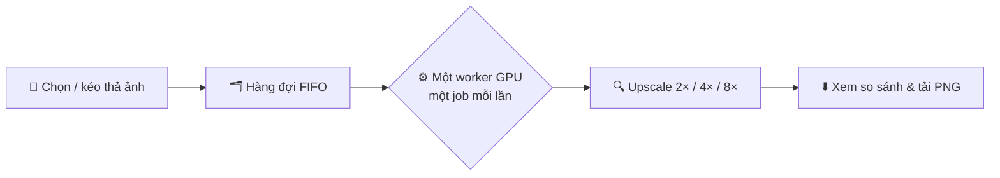
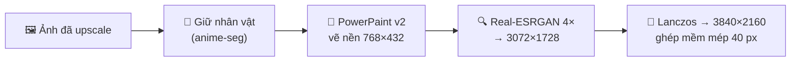

# HaUps

**Upscale ảnh và tạo hình nền AI — chạy hoàn toàn trên máy Windows của bạn.**

   

> Không tài khoản, không API key, không cloud. Ảnh không rời khỏi máy. (Tên cũ: Upmods.)

---

## Tổng quan

HaUps có hai chức năng chính:

| | 🖼️ Upscale ảnh | 🌄 Hình nền AI |
|---|---|---|
| **Đầu vào** | PNG / JPG / WebP tĩnh, 8-bit | Ảnh đã upscale xong |
| **Đầu ra** | 2×, 4× hoặc 8× | PNG **3840 × 2160** |
| **Model** | Ảnh chụp: `realesrgan-x4plus` · Anime: `haups-anime-x4` | PowerPaint v2 vẽ nền + Real-ESRGAN 4× |
| **Tốc độ tham khảo** | Anime ~3–4 s/ảnh (đo mẫu, RTX 4050) | Ca thường ~3 phút/ảnh; ca SDXL ~5,5 phút |
| **Cần** | Engine NCNN + model (xem [Cài đặt](#cài-đặt)) | Thêm môi trường `quality-upgrade` và weights |

### Luồng xử lý upscale



### Luồng tạo hình nền AI



> Nếu cả 3 seed PowerPaint đều hỏng, app chuyển sang SDXL-inpaint để vẽ lại dải nền. Preset anime khi không nhập mô tả sẽ tự thêm thẻ bối cảnh (WD14 tagger) vào prompt.

---

## Bắt đầu nhanh

```powershell
start.bat
```

Mở trình duyệt tại **http://127.0.0.1:8765**. Giữ cửa sổ server chạy trong lúc dùng.

---

## Cách dùng

1. **Chọn ảnh** — chọn hoặc kéo thả tối đa **20 ảnh/lần**. Chọn hệ số **2× / 4× / 8×** rồi nhấn **Thêm vào hàng đợi**. Có thể thêm lượt mới khi hàng đợi đang chạy.
2. **Theo dõi** — mỗi ảnh có trạng thái: ⏳ đang chờ → ⚙️ đang xử lý → ✅ hoàn tất hoặc ❌ lỗi. Ảnh lỗi không chặn ảnh sau.
3. **So sánh** — bên trái là ảnh gốc, bên phải là ảnh upscale. Kéo để so sánh, chuột phải đặt vạch tại điểm nhấn, zoom bằng con lăn hoặc phím.
4. **Tải PNG** — tải kết quả về trước khi dữ liệu tạm được dọn.

### Chọn loại ảnh

| Preset | Dùng cho | Model |
|---|---|---|
| 📷 **Ảnh chụp** | Cảnh quan, vật thể, người thật | `realesrgan-x4plus` |
| 🎨 **Anime / Minh họa** *(mặc định)* | Ảnh vẽ, truyện tranh, hoạt hình | `haups-anime-x4` |

> Hai preset này do bạn chọn thủ công; app không tự nhận diện nội dung ảnh.

### Ví dụ kích thước

| Ảnh gốc | 2× | 4× | 8× |
|---|---|---|---|
| 666 × 1000 px | 1332 × 2000 | 2664 × 4000 | 5328 × 8000 |

---

## Hình nền AI

Sau khi ảnh upscale xong, chọn ảnh trong hàng đợi rồi nhấn **Tạo hình nền AI**.

- Ảnh chính giữ nguyên tỷ lệ (contain). File PNG 3840 × 2160 được lưu riêng, **không ghi đè** ảnh gốc hay bản upscale.
- Có ô **Mô tả nền** (tiếng Anh, tùy chọn). Có mô tả: app vẽ lại toàn bộ nền theo mô tả. Không có: giữ nguyên khung ảnh gốc.
- Sau lần tạo tự động, UI hiện dòng **“AI nhận ra: …”** để bạn biết AI đã hiểu bối cảnh thế nào.
- Thời gian tham khảo: ~3 phút/ảnh (ca thường), ~5,5 phút (ca SDXL, timeout 10 phút).

> ⚠️ Có thể còn đường nối (seam) hoặc chi tiết mới khác bản vẽ gốc. Kết quả không được bảo đảm cho mọi ảnh.

---

## Cài đặt

### Yêu cầu

- Windows 10/11, GPU NVIDIA có driver và Vulkan (đã kiểm thử trên RTX 4050 Laptop ~6 GB VRAM)
- Python **3.12** (đã kiểm thử)

### Các bước

```powershell
py -3.12 -m venv .venv
.venv\Scripts\python.exe -m pip install -r requirements.txt
.\start.bat
```

### Engine và model

Repo **không chứa** engine, weights hay ảnh cá nhân (đã được `.gitignore` loại trừ).

- Dùng bản official `realesrgan-ncnn-vulkan`. Đặt biến `HAUPS_ENGINE_DIR` trỏ tới thư mục chứa `.exe`, DLL và `models/`.
- Nếu máy có nhiều GPU, đặt `HAUPS_GPU_ID` theo danh sách của `vulkaninfo --summary`.
- Chỉ dùng binary và weights có nguồn rõ ràng, đã kiểm hash.

---

## Giới hạn

| Hạng mục | Giá trị |
|---|---|
| Số ảnh mỗi lượt | 20 |
| Ảnh chưa hoàn tất tối đa | 100 |
| Pixel mỗi ảnh | 16 triệu |
| Pixel mỗi ảnh khi 8× | 10 triệu |
| Dung lượng mỗi file | 50 MB |
| Dung lượng mỗi lần tải lên | 1 GB |
| Ngân sách đĩa | 16 GiB |
| Thời gian lưu kết quả | 24 giờ (dọn khi mở app hoặc thêm lượt mới) |
| Định dạng nhận | PNG / JPG / WebP tĩnh 8-bit |
| Không nhận | Ảnh động, CMYK, PNG 16-bit |

Chi tiết kỹ thuật:

- **8×** = model AI 4× rồi Lanczos lên 8×. Không phải model 8× native, không đảm bảo thêm chi tiết thật.
- Anime dùng tile 128 và tự giảm 64 → 32 khi thiếu VRAM; photo dùng tile 64 → 32. TTA tắt.
- Mỗi lượt có deadline subprocess 10 phút, kể cả retry.
- Bản upload đã sửa hướng EXIF, chuyển ICC về sRGB và bỏ metadata.
- Đóng tab không dừng xử lý. Ctrl+C trong cửa sổ server: chờ ảnh hiện tại xong rồi dừng; ảnh đang chờ được chạy tiếp khi mở lại.

---

## Cấu trúc thư mục

```text
HaUps/
├── app/        FastAPI: HTTP, hàng đợi, engine adapter, hình nền, khóa, bảo mật
├── web/        Giao diện HTML/CSS/JS thuần — không CDN, không analytics, không cần build
├── lab/        Script thí nghiệm: outpainting và upscale (không thuộc app chạy hằng ngày)
├── tests/      pytest + Playwright
├── docs/       Ghi chép nghiên cứu và benchmark
└── start.bat   Khởi động app
```

Dữ liệu hàng đợi lưu ở `.haups-data/` (hoặc `HAUPS_DATA_DIR`) và không được commit.

---

## Kiểm thử

```powershell
.venv\Scripts\python.exe -m pip install -r requirements-dev.txt
.venv\Scripts\python.exe -m pytest tests -q
.venv\Scripts\python.exe -m ruff check app tests --select E9,F
```

Test web cần Chromium trong cache Playwright (`%LOCALAPPDATA%\ms-playwright\chromium-*`). Có thể chỉ định bằng biến `HAUPS_CHROME_PATH`.

Test GPU là bước riêng, cần chạy thủ công với `HAUPS_DATA_DIR` riêng, không chạy trên server đang giữ hàng đợi thật.

---

## Lỗi thường gặp

| Triệu chứng | Cách xử lý |
|---|---|
| Port 8765 đã dùng / HaUps đã chạy | Dùng server đang mở. Không tăng số worker hay bỏ khóa. |
| Không thấy NVIDIA Vulkan | Kiểm tra `vulkaninfo --summary` và driver. |
| Thiếu engine hoặc model | Kiểm tra `HAUPS_ENGINE_DIR` và cặp `.bin`/`.param`. UI chỉ hiện preset có đủ file. |
| Không đủ VRAM | Đóng app GPU khác, chọn ảnh nhỏ hơn, thêm lại ảnh lỗi. |
| Không ghi được trạng thái | Kiểm tra dung lượng đĩa và quyền ghi, rồi khởi động lại. |

---

## Trạng thái hiện tại

- Đã kiểm tra xử lý tuần tự và kết quả GPU thật trên ảnh mẫu nhỏ.
- **Chưa nghiệm thu chất lượng** cho mọi nhóm ảnh, ảnh lớn, alpha hay nhiều profile màu. AI có thể làm mịn hoặc tạo chi tiết mới.
- Chưa kiểm kê đầy đủ license từng weights/DLL, nên **chưa phát hành lại** engine hay model.
- Chưa có hủy job, sắp xếp lại hàng đợi, hay tải ZIP cả bộ.

Dự án cá nhân, dùng riêng. Mã nguồn đăng GitHub ở chế độ private.
